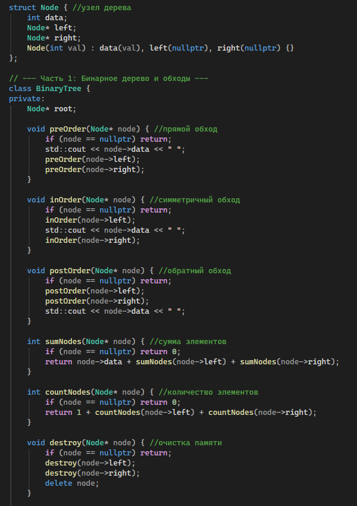
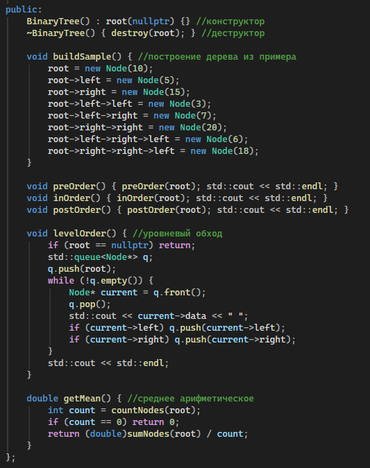
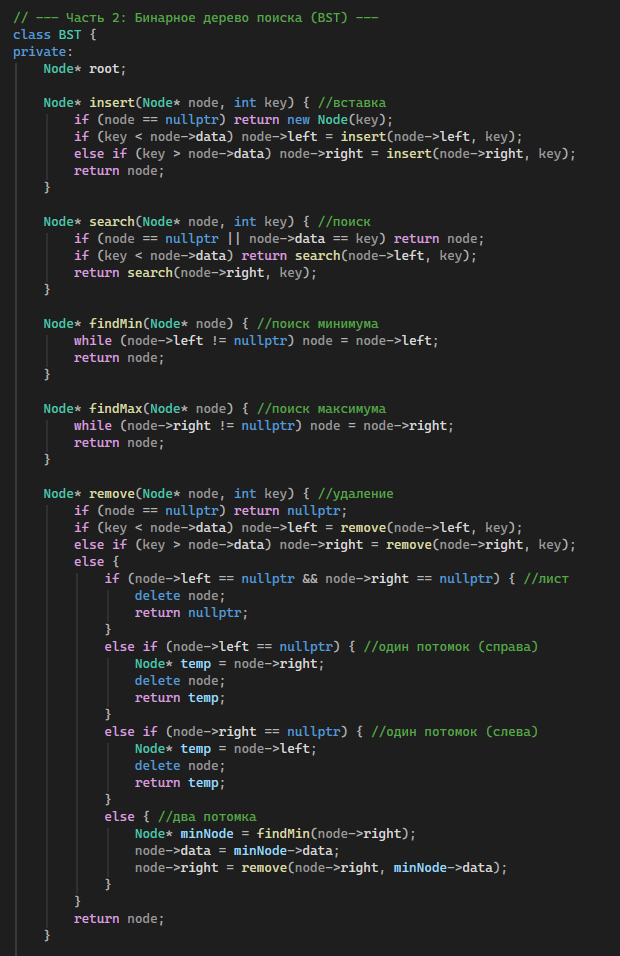
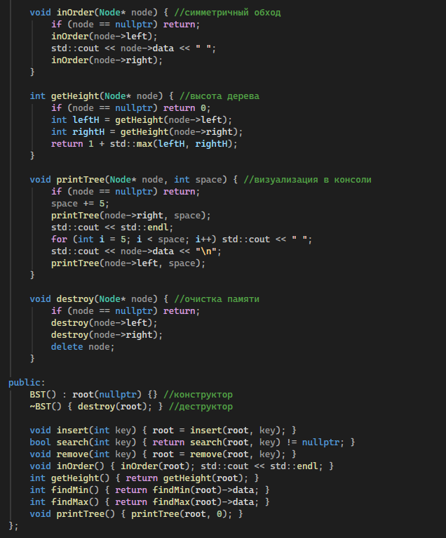
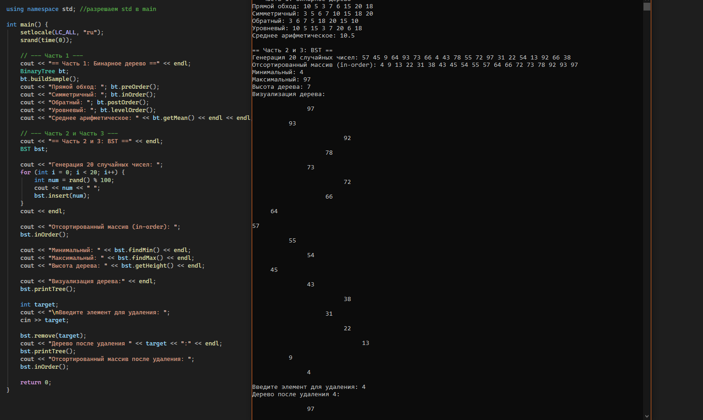

# Отчет к лабораторной работе № 9
# Тема: Бинарное дерево. Обходы. BST 
# Дисциплина: Алгоритмы и структуры данных
## Выполнил: Бойко Андрей Сергеевич ПИЖ-б-о-25-2
# Цель:
1. Реализовать структуру данных «бинарное дерево» и изучить различные способы его обхода (прямой, симметричный, обратный, уровневый) 
2. Реализовать бинарное дерево поиска (BST) с операциями вставки, удаления и поиска 
3. Освоить применение рекурсии для работы с деревьями 
4. Проанализировать сложность операций в BST 
5. Научиться визуализировать структуру дерева 
# Ход работы

Реализовал класс самого дерева

Добавил функции согласно заданию

Реализовал бинарное дерево поиска

Проверка работы программы и вывод
# Вывод:
1. Реализовали структуру данных «бинарное дерево» и изучили различные способы его обхода (прямой, симметричный, обратный, уровневый) 
2. Реализовали бинарное дерево поиска (BST) с операциями вставки, удаления и поиска 
3. Освоили применение рекурсии для работы с деревьями 
4. Проанализировали сложность операций в BST 
5. Научились визуализировать структуру дерева 
# Ответы на контрольные вопросы:
1. Обычное бинарное дерево не имеет правил упорядочивания, а в BST для каждого узла выполняется условие: все ключи в левом поддереве меньше узла, а в правом - больше.
2. Существует 4 вида обхода: прямой (корень-лево-право), симметричный (лево-корень-право), обратный (лево-право-корень) и уровневый (по уровням с помощью очереди).
3. Отсортированную последовательность для BST дает симметричный (in-order) обход.
4. Сложность операций поиска, вставки и удаления в среднем O(log n), а в худшем O(n); она зависит от высоты дерева.
5. Если вставлять элементы в отсортированном порядке, дерево становится вырожденным (похожим на связный список), и его высота становится равной n.
6. При удалении узла из BST нужно рассмотреть три случая: узел является листом, узел имеет одного потомка, узел имеет двух потомков.
7. Наименьший элемент находится путем постоянного перехода по левым потомкам до конца, а наибольший - по правым.
8. Высоту дерева рекурсивно вычисляют как 1 + максимум из высот левого и правого поддеревьев (базовый случай - пустое дерево дает 0).
9. LCA - это самый нижний узел, который является предком сразу для двух заданных узлов (то есть от него можно дойти до обоих).
10. Чтобы проверить, является ли дерево BST, нужно выполнить симметричный обход и убедиться, что полученная последовательность строго возрастает.
11. Сбалансированное дерево - это дерево, где разница высот левого и правого поддеревьев для каждого узла не превышает 1; это важно, чтобы высота оставалась O(log n) и операции работали быстро.
12. Чтобы сбалансировать BST, нужно сохранить его элементы в отсортированный массив (через in-order) и затем построить новое дерево, беря середину массива как корень.
13. Первый элемент pre-order - это корень; находим его в in-order, элементы слева от него - левое поддерево, справа - правое; затем рекурсивно повторяем процесс.
14. Итеративный обход реализуется с помощью ручного стека (для pre, in, post) или очереди (для level-order) вместо использования рекурсивных вызовов.
15. Бинарное дерево - это иерархическая структура, где каждый узел имеет не более двух потомков (левого и правого); состоит из узлов, содержащих данные и указатели на потомков.

